# Web-UI: login og Mine data

Setup-UI'et (`/`) er der, hvor du logger ind i Aula med MitID, og hvor du ser, hvad aula-mcp har hentet og gemt om din familie. Billederne herunder er taget med **opdigtede eksempeldata** (børnene Alma og Theo på "Solsikkeskolen"), ikke fra en rigtig Aula-konto.

Prøv det selv uden Aula-login:

```sh
bun run demo:web-ui        # http://127.0.0.1:8765/
bun run docs:web-ui        # tager billederne i docs/web-ui/ igen (kræver Google Chrome)
```

Demoen sender intet til Aula. Knapper, der ville ændre noget i Aula (meld syg, ferie/fri, komme/gå), svarer med en fejl.

## Oversigt

Login-status, børnene med dagens komme/gå, hvad der er gemt, synkroniseringen, galleriet og de næste begivenheder.

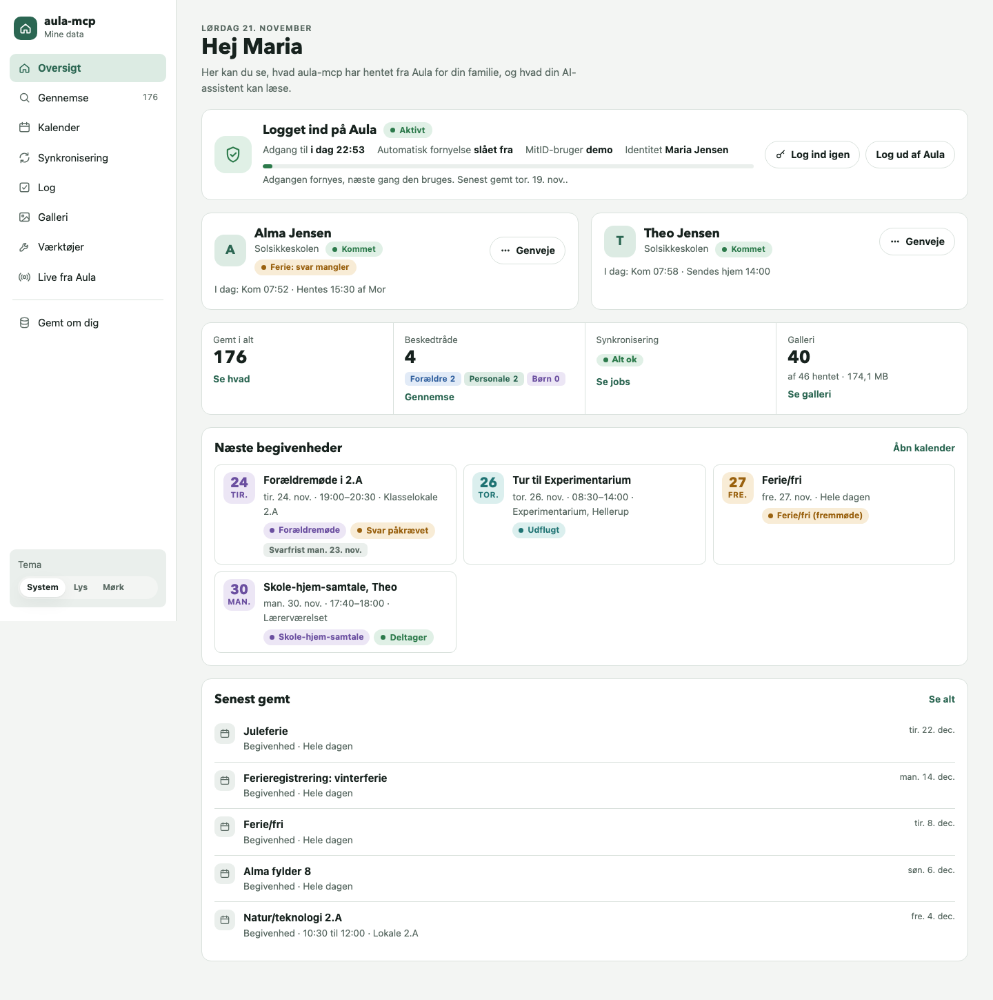

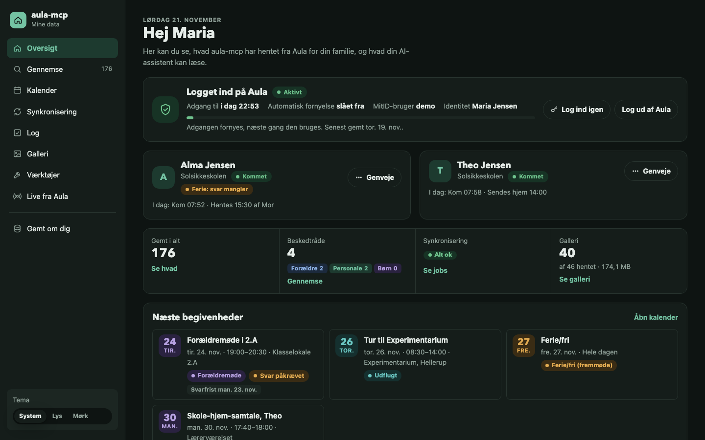

På telefonen, og menuen **Genveje** for et barn: meld syg, ændr komme/gå, meld eller fjern ferie/fri og svar på ferieregistreringer. Alt, der ændrer noget i Aula, skal bekræftes på siden først.

<p>
  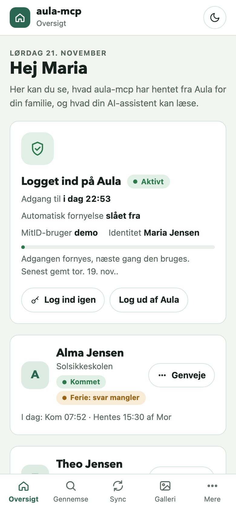
  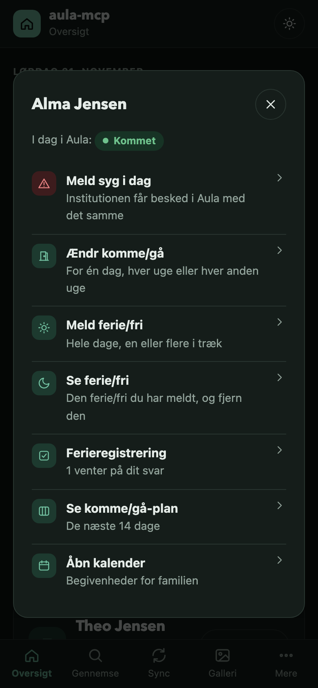
</p>

## Kalender

Måned, uge og liste. Ferie/fri, du selv har meldt, er gul; ferie/fri, som en anden har meldt (institutionen eller den anden forælder), er blågrå: **Ferie/fri, ikke meldt af dig**.

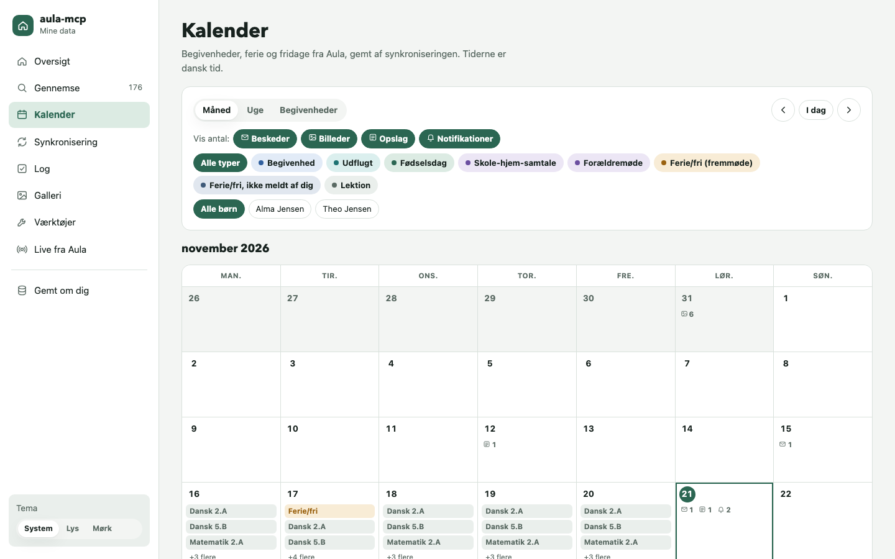

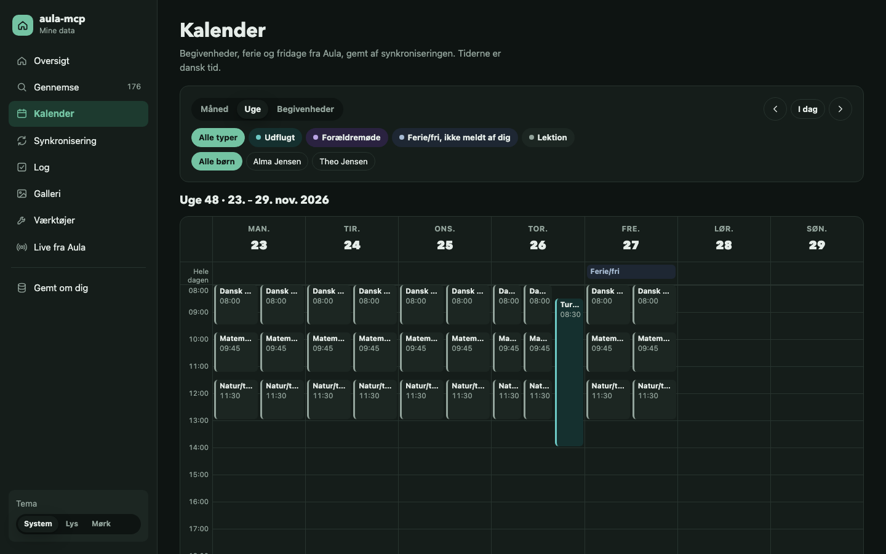

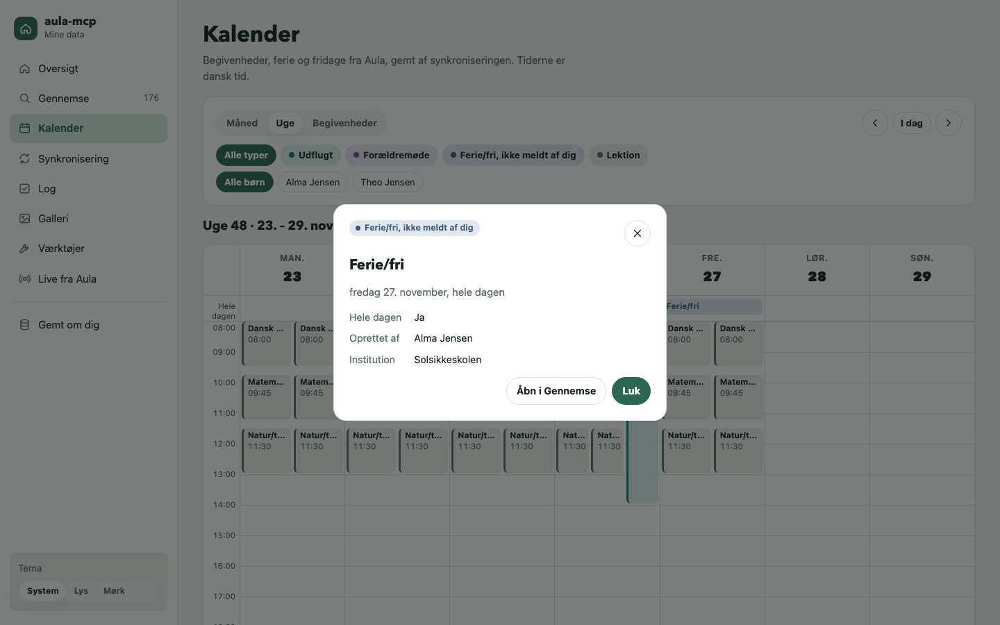

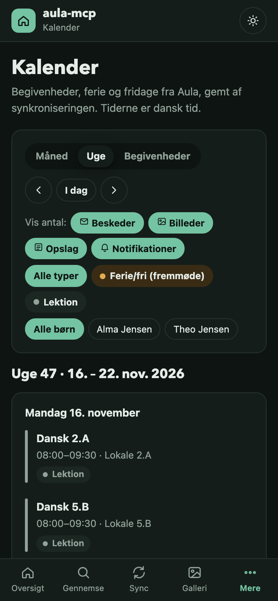

## Gennemse

Alt, hvad synkroniseringen har gemt: beskeder, opslag, notifikationer, kalender, fremmøde, grupper og galleri, med søgning og filtre.

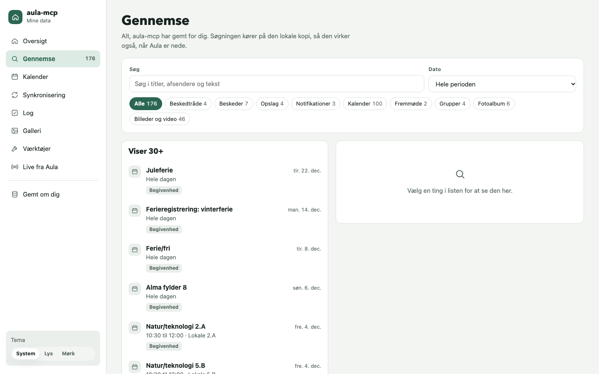


## Galleri

Albums og billeder hentet i original kvalitet, med miniaturer. Filerne vises gennem dashboardet; der udleveres ingen signerede Aula-links.

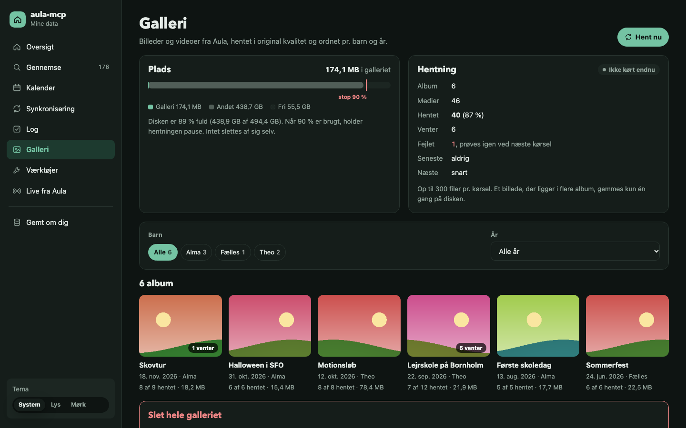

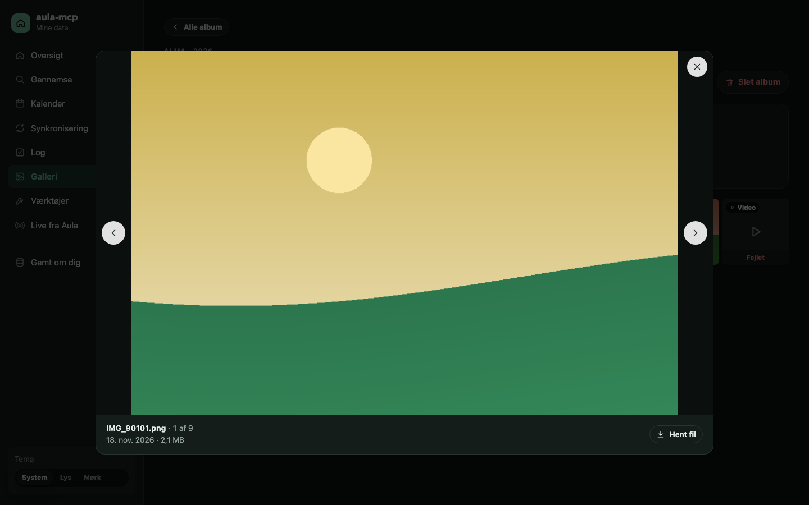

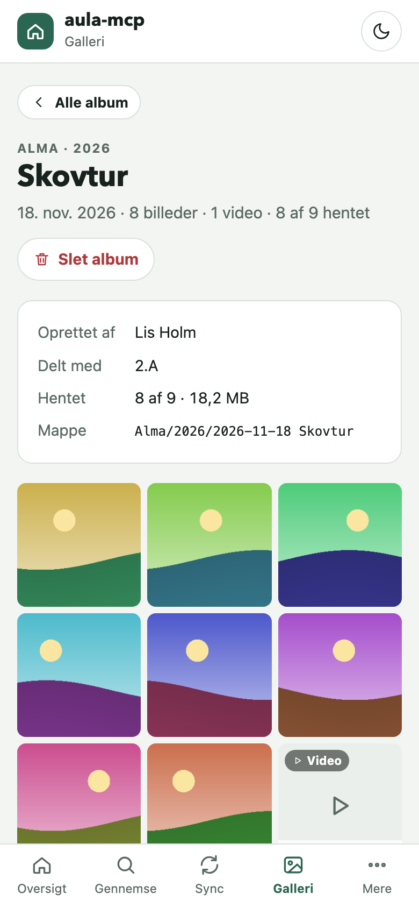

## Synkronisering og log

Hvert job, hvornår det sidst kørte, hvad det hentede og ændrede, og loggen over hvad aula-mcp har gjort. Loggen indeholder kun antal, id'er og fejltekster, aldrig indholdet fra Aula.

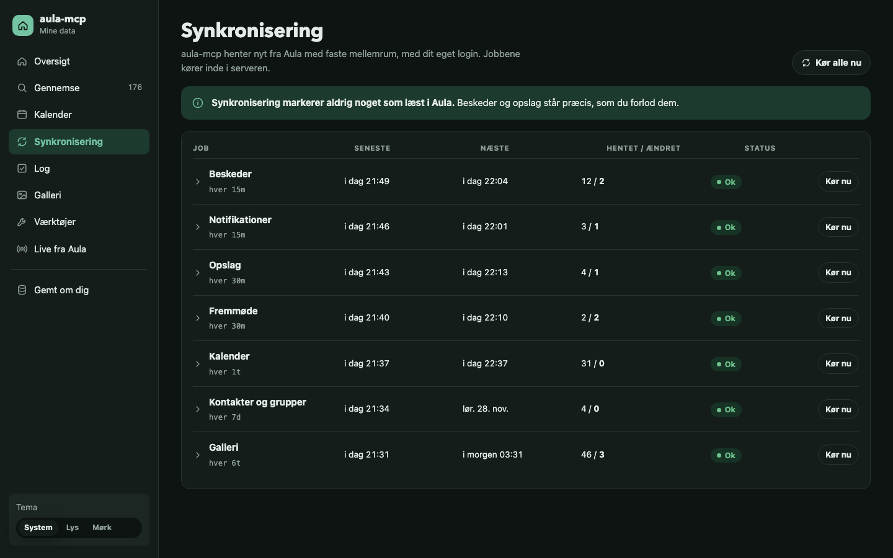

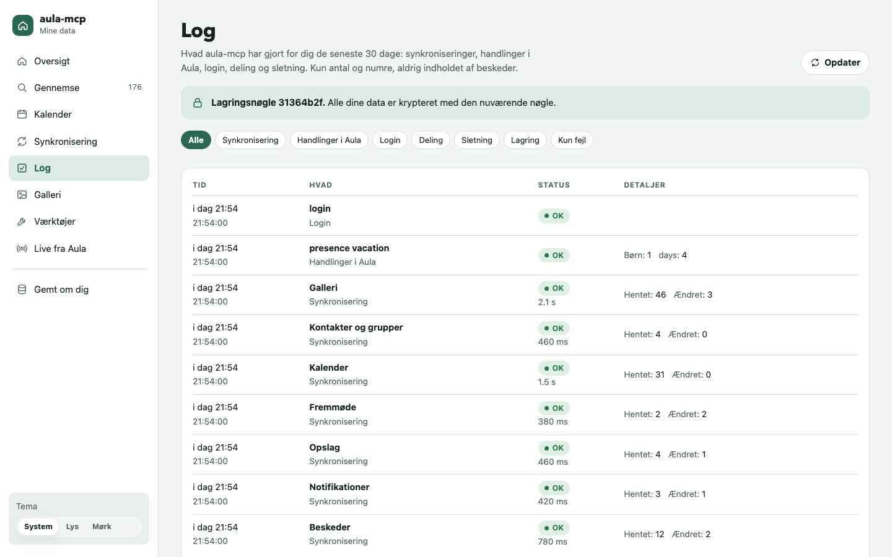

## Værktøjer, live og gemt om dig

De MCP-værktøjer, AI-assistenten kan bruge, hvad den kan læse live fra Aula, og hvad aula-mcp gemmer om dig.

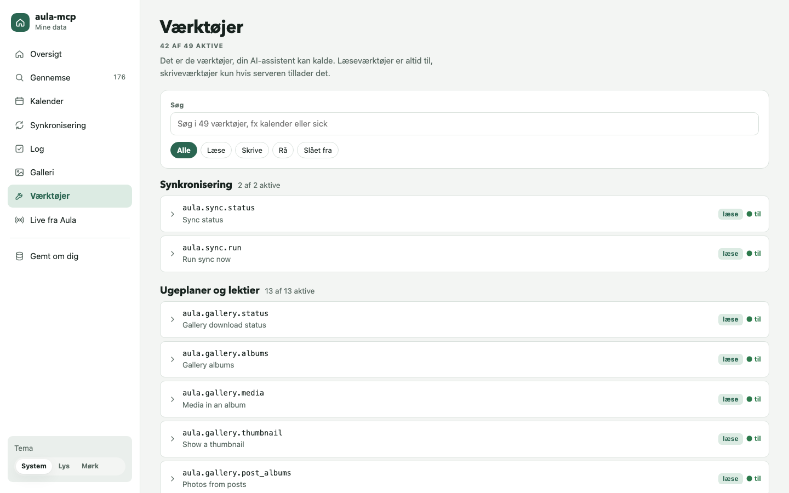

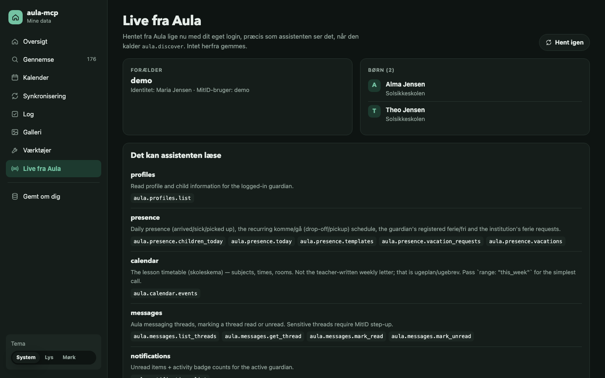

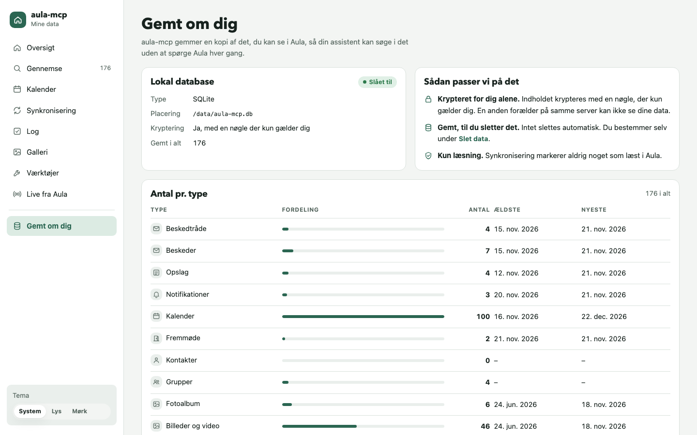
